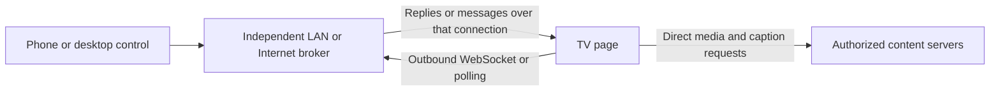

# Philips firmware, browser internals and the TV-hosted server question

Later analysis setup correction: Ghidra12.1.3 was already installed. REA's
Homebrew-wrapper lookup missed libexec; explicit existing Ghidra/JDK paths now
pass actual native-control import/analysis/decompile. The firmware payload still
has no decoded native binary. A [later reassessment](philips-ghidra-reassessment.md)
records full UPG loader/filesystem negatives, rejected filesystem candidates,
expanded default-key/hash checks and new vendor upgrade/gateway source leads.
[Verified setup and DevView protocol](philips-devview-protocol.md).

Research date: 2026-10-20. Target: Philips **43PFG6910/78**, running
**TPM256L_V251.003.105.021**. This report answers how the available browser
features connect to lower layers and what would be required for a Kodi-like
receiver. Android remains outside scope.

Latest continuation: [live probe control and privileged-interface results](philips-probe-control.md)
records actual ping/label/DOM receipts, vendor constructor-registry discovery,
the standard HbbTV object test and a successful REA archive inventory. A TV-side
TCP listener and readable native components remain unestablished.

## What we have now

We obtained a complete **current-version firmware archive** from the official
[TPV firmware host](https://portaltpv.com.br/down-rede/up-software/UPG_TPM256L_251.003.105.021.zip).
Its filename was inferred from the already verified older vendor URL; the full
body subsequently confirmed the version in the member header. This is stronger
than an HTTP200 or a matching filename, but it is not a readback of installed
flash or verification of a publisher cryptographic signature.

| Artifact | Validated observations |
| --- | --- |
| Current ZIP | 608,732,145 bytes; one `Autorun.upg`; complete ZIP-member CRC verified |
| Current UPG | 608,642,544 bytes; `TPM256L_V251.003.105.021` at offset256 |
| ZIP SHA-256 | `c799ee6a3a0df91d4e08d3c1345aca7e68e18436df43b7d38d7cfc8aadc75151` |
| UPG SHA-256 | `fcc957435f0d5a8e95cd45322e8765fc04bf0aec95bd97e6a5dca682056eeb0a` |
| Older comparison | Complete251.002.192.121 archive/member also downloaded, hashed and CRC checked; not substituted for the current build |
| Live runtime | Page execution, heartbeats and automatic source refresh verified on the identity-matched TV |
| Readable native implementation | No filesystem, browser executable or vendor media/GPU library extracted yet |

Artifacts, source captures and hashes are ignored under
`.local/tv-hello/firmware-deep/`. Nothing was uploaded, installed or flashed.

The current UPG matches the markers and field layout in the public
[`unixtract` secure MStar/MediaTek reader](https://github.com/theubusu/unixtract/blob/144cf51e3e1b6e832119fde60f676a6def8266f7/src/formats/mstar_secure_new/include.rs):
`MTK.....` at0x500, `.....mtk` at0x578, 5,242,880-byte segments, payload at4096,
payload length608,632,832, hash-region offset608,636,928 and length5,616.
The regions exactly fill the member. The
[reader implementation](https://github.com/theubusu/unixtract/blob/144cf51e3e1b6e832119fde60f676a6def8266f7/src/formats/mstar_secure_new/mod.rs)
uses AES-256-CBC and tests candidate keys for a readable upgrade script. A
bounded128-byte check using its one public default key did **not** yield a
recognized script for either build. The full reader was not run. This supports
identifying the container family; it does not establish a working decryption
key, authenticate its signatures, or prove that no other supported decoder exists.
The later reassessment independently decoded each complete first5MiB segment
with that same default key: no script marker, and no match against its48-byte
plaintext-hash record. This expands the earlier sample without claiming a full
reader run or a working key.

A full-member scan found no ELF or little-endian SquashFS magic. Two short
current-image matches for other filesystem magic were unvalidated candidates,
not extracted files. Later structural validation rejects both as false positives.
Sample entropy near8 bits/byte cannot independently prove
encryption. These byte observations are recorded separately from the positive
container-layout match in `current-full-inspection.json` and
`container-analysis.json`.

REA's available firmware adapter requires caller-supplied Linux Binwalk/Unblob
and admits inputs at most128MiB. Those prerequisites are unavailable on this Mac;
the complete UPG is larger than that limit. It was not presented as a successful
REA extraction. A validated extracted component would be the next suitable
input. [REA's documented boundaries](https://github.com/morluto/rea/blob/main/docs/firmware-analysis.md)
explain the distinction between region inspection and extracted executables.

## How exact the implementation account can be

The live browser advertises Chrome112.0.4147.62, OMI4.24, Opera46.0.2207.0 and
TitanOS3.0. The TPM256L vendor table says Chromium122; Vewd's generic4.24 table
refers to114. None identifies an executable commit. We therefore use three
explicit evidence levels:

1. **Measured on this TV:** exposed interfaces, fixed media declarations,
   geometry/context and successful probe traffic.
2. **Verified source references:** exact upstream Chromium112.0.5615.49,
   resolved to commit `8e1a5127113793e25c8192936365df9c2b0fa496`, its pinned
   V8/ANGLE dependencies, and the public Titan SDK/container-reader sources.
3. **Unresolved vendor implementation:** build patches, compiled flags, native
   media/GPU/network adapters, permissions, startup services and actual binary
   addresses. We cannot supply exact Philips functions here before extracting
   matching components or obtaining the corresponding vendor source.

The [exact-model manual](https://www.documents.philips.com/assets/20250325/8209e624f4694ae9a48bb2ab00357e47.pdf),
printed pp.53–56, offers corresponding open-source code by English request to
`open.source@tpv-tech.com` and
lists Linux4.19, glibc2.30.0, GStreamer1.18.3 and OpenSSL1.1.1l among its license
inventory. That inventory does not prove those exact versions, linkage or paths
in this running image. No corresponding-source archive was found and no vendor
message was sent. A standard webpage can expose capability metadata and files
explicitly supplied to it; it has no standard API for dumping arbitrary firmware
files or recovering native function implementations.

## The server question: which layer owns the listening socket?

For direct Kodi-style LAN HTTP/JSON-RPC access, a component on the TV must bind
an address/port, listen, accept connections, parse requests and dispatch commands.
The TV already has native listening services—our paired JointSPACE requests
worked—so the unresolved issue is whether **our app** can obtain that capability.
The browser's WebAssembly/WebGL exposure does not grant it automatically.

| Measured interface in the current HTTP page | Result | What that establishes |
| --- | --- | --- |
| `WebSocket` | Exposed | A client interface for an outgoing bidirectional connection; handshake not tested |
| `RTCPeerConnection` | Exposed | A possible negotiated peer/data-channel route; no constructor/ICE/connection tested |
| `TCPServerSocket` | Not exposed | No such constructor available to this page |
| `TCPSocket`, `UDPSocket` | Not exposed | No such raw-socket constructors available to this page |
| `WebTransport` | Not exposed | No such constructor available here; it is also not an ordinary inbound HTTP listener |
| Secure / cross-origin isolated | false / false | Current LAN HTTP context; not an inventory of privileged app permissions |

The new fixed presence-only sample arrived with GET1/ready1/heartbeat1,
rejected0 and matching source/loaded revisions. It constructed no socket and
requested no permission. Evidence is `socket-profile.json`.

There is an important upstream exception. Chromium112 contains experimental
[`TCPServerSocket`](https://github.com/chromium/chromium/blob/8e1a5127113793e25c8192936365df9c2b0fa496/third_party/blink/renderer/modules/direct_sockets/tcp_server_socket.idl)
for specially privileged contexts. Its path is:

```text
TCPServerSocket::Create / Open
  -> Socket::CheckContextAndPermissions
  -> Mojo DirectSocketsService::OpenTCPServerSocket
  -> browser DirectSocketsServiceImpl
  -> NetworkContext::CreateTCPServerSocket(local address, backlog, ...)
```

The IDL requires secure and isolated contexts plus the experimental runtime
feature. Blink and browser code also check the direct-sockets policy; the browser
accepts a qualifying isolated-application level OR an embedder allow decision.
A page's `crossOriginIsolated` boolean, HTTPS headers, or compiled WASM alone is
not that authorization. DevView/vendor app permissions remain unmeasured. The
[browser internals appendix](philips-browser-internals.md) links each exact gate
and source function, including that OR condition.

### What WebAssembly and WebGL could implement

WASM can implement an HTTP parser/router, media/container parsing, caption
conversion, library indexing and other computation. V8 instantiates a module
against explicitly supplied imports, including functions, memories, tables and
globals. Socket function imports such as a compiled `socket()`, `bind()` or
`listen()` need host implementations; the import name does not
resolve a Linux libc symbol. Emscripten's referenced browser socket layer does
not provide listening: its `listen` implementation returns EOPNOTSUPP outside
Node, and its full POSIX route uses a separate native proxy. WASI socket interfaces
would likewise need a runtime/host provider; browser WASM presence is insufficient.

WebGL can implement the interface, effects or graphics/computation expressible
through its shader and draw APIs. The reference path is Blink validation → GLES
command buffer → GPU-service decoding → ANGLE/driver compilation. It supplies
no bind/listen import. It is also separate from the hardware video decoder:
rendering a video texture does not reveal the decoder's private firmware API.
Neither route currently gives this page a TV-hosted HTTP server.

### Two concrete control architectures

A browser receiver can own playback without listening for incoming TCP:



Our existing report/reload polling proves the basic outbound request/reply path.
Fixed ping/label command delivery and handler receipts are now implemented and
TV-verified in the [live follow-up](philips-probe-control.md). Media commands
remain proposed. An external
broker remains necessary for that architecture's network control. Once media
has been handed off, the phone may be off only if ongoing media, captions,
authorization and hosting do not depend on it. The TV page must also remain alive;
background/exit policy has not been measured.

A true TV-hosted service would instead require either an exposed privileged
Direct Sockets app or a supported native/vendor helper. In a native Linux helper,
the transport layer would create a socket, bind an unprivileged configured port,
listen, accept, perform HTTP/WebSocket framing/authentication and dispatch an
allowlisted player protocol. It would need an actual supported bridge to the
TV player; the Linux `socket()` call alone does not control a media element in
another process. Packaging, launch authority, bridge IPC, persistence and
background service lifetime all remain unknown on this firmware. This is an
implementation requirement, not an available installation procedure.

## What each feature does below the app

| Feature | Concrete reference implementation | What our app would use it for |
| --- | --- | --- |
| Fetch / HTTP / TLS | Blink GlobalFetch/FetchManager → loaders → Mojo URLLoaderFactory → network service → net::URLRequest; TLS uses SSLClientSocketImpl and BoringSSL | Manifests, segments, captions and control requests; handle CORS/TLS/errors rather than assume raw socket access |
| WebSocket | DOMWebSocket → WebSocketChannelImpl → browser connector → network WebSocketChannel | Persistent outbound commands/status; reconnect and resynchronize without reopening playback |
| Promise | V8 promise reaction jobs and microtask queue, driven by Blink event-loop checkpoints | Async completion/error propagation; no daemon lifetime or special I/O authority |
| WebAssembly | V8 compilation/instantiation plus explicitly provided imports | Optional compute-heavy parsing/conversion; no replacement for missing host permissions |
| WebGL / WebGL2 | Blink state validation → GLES commands → GPU-service/ANGLE/backend | Remote-friendly graphics after real context/performance validation |
| MediaSource | Blink MediaSource/SourceBuffer → byte-stream parsers → ChunkDemuxer → selected media pipeline | A JS adaptive player feeding supported MP4/WebM segments |
| Native media URL | HTMLMediaElement → embedder WebMediaPlayer/renderer factory → vendor or configured demux/decode route | Progressive MP4 and native HLS/DASH candidates; vendor streaming backend unresolved |
| localStorage / IndexedDB | Renderer APIs/caches → browser/storage services → policy-selected disk or memory backing | Preferences/catalog state after persistence/quota checks, not arbitrary firmware filesystem access |
| EME / VideoDecoder | Secure/context/runtime gates → configured CDM/decoder factories | requestMediaKeySystemAccess and VideoDecoder absent in this HTTP page; other WebCodecs surfaces unprobed; exposure would still require configuration/decoding checks |
| Service worker / subtle crypto | Secure-context interfaces → registration/crypto services | Scoped caching or crypto if available; neither creates an incoming server or permanent service |

Exact paths, named functions, dependency revisions and source links are in
[browser internals](philips-browser-internals.md) and
[media internals](philips-media-internals.md). The latter also shows why
canPlayType and MSE declarations can disagree, and exactly where upstream code
hands off to an embedder-selected renderer/backend. Identifying that factory
in the actual Philips binary is necessary before claiming the MediaTek/GStreamer
implementation or codec hardware path.

## Necessary receiver functions and how we would implement them

These are proposed app operations, not new methods already exposed by the TV.
Keep the transport replaceable so polling/WebSocket and a future privileged
listener can call the same player controller.

| Function | Implementation and completion evidence |
| --- | --- |
| `connectControl()` | Open a supported outbound channel or poll an authenticated queue; publish a fresh page instance ID; reconnect with current state. For a future inbound adapter, first prove permitted bind/accept separately. |
| `loadSource()` | Validate an explicit authorized URL/route; increment source revision; cancel old fetch/append/caption work; attach one media element or ABR adapter; observe metadata/adapter readiness. Do not report picture/sound from an accepted command. |
| `play()` / `pause()` | Use explicit desired state, handle play-promise rejection, observe playing/paused state and clock progress. Avoid retryable toggles. |
| `seek(seconds)` | Clamp against current seekable ranges; permit one active seek and coalesce unsent scrubs; finish on seeked plus time readback for the same source revision. |
| `appendSegment()` | MSE route only: serialize SourceBuffer append/remove operations, respect updating/updateend, timestamp/discontinuity state and quota; reject stale source generations. |
| `setSubtitle(id, offset)` | Fetch only selected captions with valid origin/CORS access; parse/convert to WebVTT cues, select textTrack or a DOM renderer; keep original times so offset changes do not accumulate drift; observe loaded/selected state separately from visible rendering. |
| `selectAudio(id)` | Use actual exposed audioTracks or the selected ABR adapter; scope IDs to the source; report unsupported if the route cannot enumerate/select. |
| `setVolume()` / `setMuted()` | Change element gain/mute and observe readback. Physical TV/AVR volume is a separate existing remote interface. |
| `getStatus()` / `subscribe()` | Report source revision, intent, observed phase, clock, duration/live state, buffered/seekable ranges, tracks, errors and control/lifecycle state. Exclude active URL tokens from logs. |
| `stop()` | Revoke source generation, pause, detach, abort fetches, destroy adapter/caption work and release object URLs. Repeated stop is harmless. |
| `requestFullscreen()` | Wrapper fullscreen with captions/controls together, when activation/context permits; observe fullscreenchange and validate physical TV composition. |
| `dispose()` / resume | Close our resources and invalidate pending callbacks; on return reconcile actual state. Do not assume a hidden tab continues or a service worker preserves playback. |

Every mutating network command needs a command ID, page instance and source
revision. Separate accepted, completed and unknown outcomes. Cache bounded
receipts; never replay an unknown load after reconnect. A control-channel loss
should not stop independent playback. The
[receiver contract appendix](philips-media-internals.md#proposed-receiver-api-player-operations-not-an-existing-kodi-endpoint)
provides proposed message shapes, state transitions and completion rules.

## Findings and the next evidence that would change them

We can describe the upstream mechanisms and design the necessary player/control
functions precisely. We cannot yet claim their exact compiled Philips/Vewd
implementation. The acquired current-version package closes the acquisition
gap; readable component extraction/corresponding source is still needed.

For the current page, polling already works, outbound WebSocket/WebRTC are
exposed but unconnected, and direct socket constructors are absent. A TV-hosted
listener therefore remains unproved. The most relevant native research target
is an approved socket/IPC/app-service interface and its lifecycle permissions,
not using WASM or GPU computation as an assumed source of socket authority.

Further physical checks should be separate milestones: first permitted control
transport, then actual MP4 audio/video, pause/seek/captions, native HLS/MSE if
needed, app lifecycle and phone-off independence. None of the source/declaration
checks in this report establishes those outcomes.
