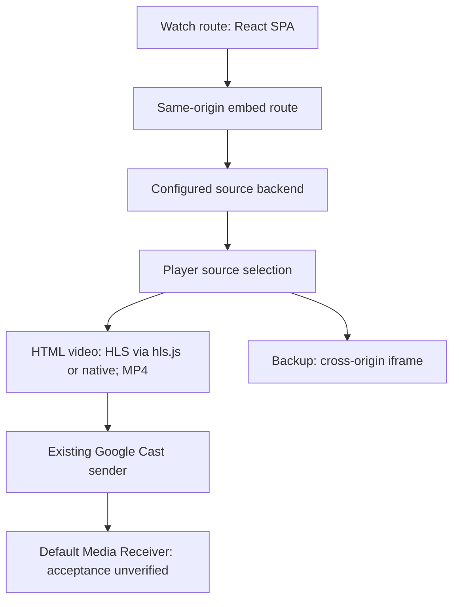

# Site architecture

Static public frontend observation: 2026-10-18; evidence hashes in
[investigation](investigation.md). Browser observations, if present, belong in
[experiments](experiments.md).

## Verified in delivered code

- HTML contains an empty `#root`, Vite module entry
  `/assets/index-BJnIXHji.js`, config preload and stylesheet. No server-rendered
  watch player is present in the initial HTML.
- Main bundle identifies React/React DOM **19.2.8** and React Router **7.18.3**;
  route components load lazily. Relevant assets are `WatchPage-DY33XwPg.js`,
  `EmbedPage-BB5N66fF.js`, and `Player-Btc_vwEb.js`.
- WatchPage constructs the same-origin embed URL from title/season/episode and
  renders `iframe[data-testid="player-iframe"]`. The iframe permits presentation,
  fullscreen and autoplay. Evidence: WatchPage offsets ~12783 and ~38333.
- Episode selection navigates to another watch route; a saved playhead can become
  an embed start-time parameter. Parent and embed exchange playback messages.
- EmbedPage parses route/parameters, selects a configured backend, queries source
  metadata, and passes sources/subtitles/provider state to Player. Source requests
  are cancellable; prior results may come from the query cache.
- Player supports a standard HTML video element; native-provider failures may
  select a cross-origin backup iframe at `vidup.to`. That path is distinct from
  the native HTML5 player and was not fetched/inspected here.

## Existing Cast matters

Initial HTML already loads the Google Web Sender SDK and initializes
`CC1AD845` with origin-scoped joining. Player adds session events, remote playback
controls and subtitle loading. Its toolbar shows the native Cast control only
when `isCastAvailable` is true (Player offset ~572850).

The wrapper must preserve a usable native button. Running in the supported
same-origin embed frame lets the wrapper inspect `video source[src]`; a broad
cross-origin-frame permission is not justified by this evidence.

## Unknown

Loaded assets, source provider and API base may vary by visit because of backend
failover, saved preferences, query cache and provider fallback. These branches
exist in code; no repeat-visit equivalence or difference is claimed without
browser evidence. Cross-origin backup internals remain unknown.
